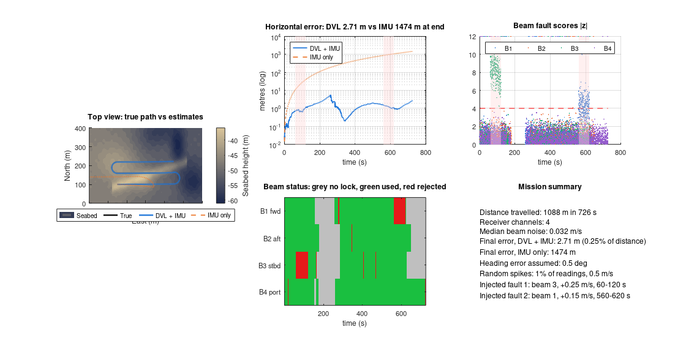

# Low-Cost Doppler Velocity Log (DVL) for AUV Navigation

**Design and simulation of a four-beam, 1 MHz DVL built from commodity parts**, with an inertial/DVL extended Kalman filter and statistically calibrated beam-level fault detection. This is the navigation study behind my Autonomous Underwater Vehicle project.

Commercial DVLs cost several thousand US dollars, which puts them out of reach of most student and low-cost vehicles. This project asks whether a cheap, noisier DVL can still give reliable navigation, and how its fault detector should be tuned.


> **Status:** simulation study. The DVL hardware has not been built yet; all results come from reproducible Monte Carlo simulations.

## Key findings

- **A single 2 ms ping is speckle-limited** to about 94 Hz of Doppler noise (≈0.07 m/s). A realistic low-cost unit delivers 39–77 Hz per 5 Hz update, not the 10 Hz often assumed.
- **Navigation still works under that noise:** position error stays at 0.22–0.43 m over 60 s, against 15.9 m for the IMU alone.
- **Common practice inflates false alarms about 30×.** Normalising beam residuals by sensor noise alone is wrong; using the full innovation covariance makes healthy residuals unit-Gaussian (std 0.998).
- **A 2-of-3 beam quarantine rule** stops the filter from absorbing persistent faults, raising isolation of a 0.05 m/s fault from 73 % to 99.95 %.
- **Deep water (3800 m / 6000 m):** uncorrected sound speed causes 1.3–3.8 % velocity scale error; a Mackenzie-equation correction reduces it to 0.15 %. The error budget is dominated by the descent, not by the DVL.

## What's in here

| Folder | Contents |
|---|---|
| `paper/` | IEEE-format paper (PDF + LaTeX source and figures). Not yet submitted or peer-reviewed. |
| `notebooks/AUV_DVL_Navigation_Study.ipynb` | Full Python study: Doppler physics, echo processing, EKF navigation, fault detection, deep-water error budget, pressure housing sizing |
| `notebooks/DVL_Variations_Study.ipynb` | Four design variations (hydrodynamic-aided EKF, 5th beam, adaptive noise, beam recovery), 200 Monte Carlo runs each |
| `matlab/` | **DVL Virtual Sea**: a live 3-D MATLAB/Octave simulator of an AUV surveying a seabed with fault injection |
| `matlab/compare/` | Pond and lake comparison of this design against a commercial DVL's published datasheet figures |

## Run the MATLAB simulator

Needs base MATLAB R2018b+ (no toolboxes) or GNU Octave 6+.

```matlab
cd matlab
run_dvl_sea          % live 3-D survey, about 1–3 minutes
cd compare
compare_pond         % design comparison, about 2–4 minutes
```

Default run (seed 7): 726 s / 1088 m survey, **final error 2.71 m with DVL + IMU vs 1,474 m with IMU alone**, 99.4 % of injected faults caught, 0.5 % of healthy readings rejected.



## Run the notebooks

Open in Google Colab or Jupyter. They need only NumPy, SciPy, pandas and Matplotlib.

**Author:** Tejas Jadhav, B.Tech Mechatronics, Symbiosis Skills and Professional University, Pune
